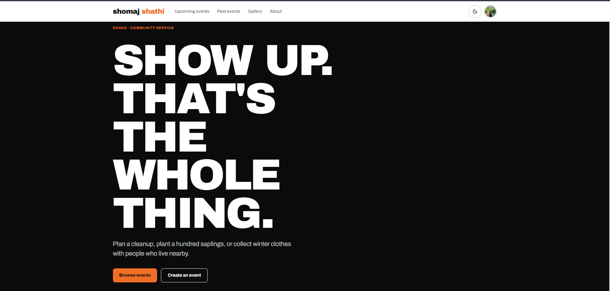
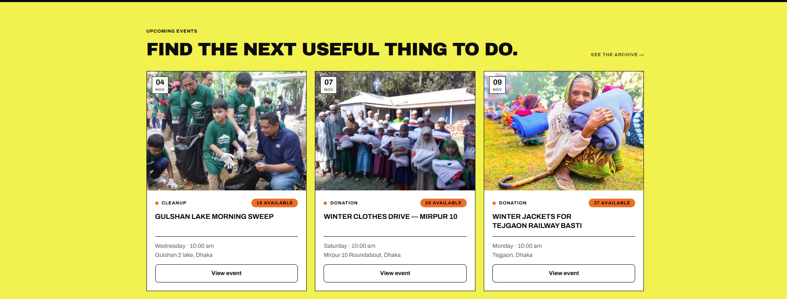
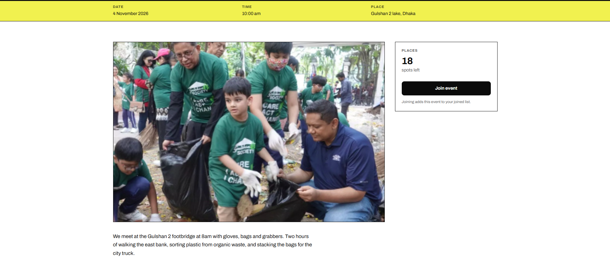
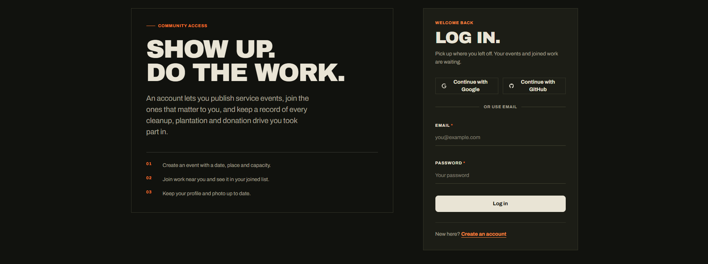
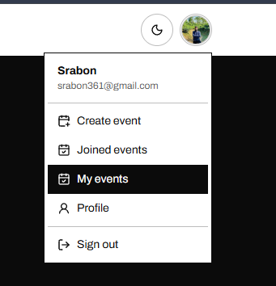

<div align="center">

# Shomaj Shathi

A civic events platform for organising and joining community service work in Dhaka — cleanups, plantations, donation drives, and education circles.

[](https://shomajshathi-app.vercel.app)
&nbsp;
[](https://shomajshathi-server.vercel.app)
&nbsp;
[](https://github.com/Srabon-bot/ShomajShathi-server)

</div>

---

## Overview

Community service in Dhaka is organised through WhatsApp groups and Facebook posts — events get lost, attendance is unknown, and there is no record of what was done. Shomaj Shathi gives organisers and participants one place to create an event, find it, join it, and track their history.

**Live site:** [https://shomajshathi-app.vercel.app](https://shomajshathi-app.vercel.app)

---

## Screenshots

<div align="center">

### Home & Navigation



### Events Directory & Search



### Event Detail & Participation



<br />

| Authentication (Dark Mode) | Member Menu |
|:---:|:---:|
|  |  |

</div>

---

## Features

- Browse upcoming community events in a poster-style grid
- Search events by keyword and filter by type
- View a full public event detail page without creating an account
- Register with name, email, photo, and password, or continue with Google or GitHub
- Authenticated avatar in the navbar with display-name tooltip on hover
- Create, edit, and delete your own service events
- Join and leave events; maintain a personal joined-events list
- View and update your profile display name and photo
- Protected member routes that survive a full browser reload
- Light and dark themes that persist across sessions
- Responsive layout from mobile to wide desktop
- Toast notifications for every create, update, join, and profile action

---

## Tech Stack

| Layer | Technology |
|---|---|
| Framework |  App Router, Server Components, middleware |
| UI library |  |
| Language |  |
| Styling |  |
| Components |   |
| Authentication |   Email/password, Google, GitHub |
| Database |  |
| Forms |   |
| Carousel |  |
| Icons |  |
| Notifications |  |
| Hosting |  |

---

## Routes

**Public**

| Route | Page |
|---|---|
| `/` | Home — hero, upcoming events, gallery carousel, area index |
| `/events` | Searchable and filterable events list |
| `/events/[id]` | Event detail with join status |
| `/events/past` | Archive of completed events |
| `/login` | Email, Google, and GitHub sign-in |
| `/register` | Account creation |

**Signed-in only**

| Route | Page |
|---|---|
| `/events/new` | Create a new event |
| `/events/manage` | Manage your own events |
| `/events/[id]/edit` | Edit an event you own |
| `/events/joined` | Events you have joined |
| `/profile` | View and update your profile |

---

## Authentication

Signed-in pages get a short-lived JWT from BetterAuth and send it to the Express API as `Authorization: Bearer <token>`. The API verifies it against the client's JWKS endpoint, and `src/proxy.ts` redirects unauthenticated visitors from protected routes to `/login`.

---

## Local Development

**Prerequisites:** Node.js 20+, a MongoDB Atlas cluster, and optionally Google and GitHub OAuth apps.

```powershell
npm ci
Copy-Item .env.example .env.local
npm run dev
```

Open [http://localhost:3000](http://localhost:3000).

Fill in `.env.local`:

```env
NEXT_PUBLIC_API_URL=http://localhost:5000
NEXT_PUBLIC_APP_URL=http://localhost:3000
BETTER_AUTH_URL=http://localhost:3000
BETTER_AUTH_SECRET=<random 32+ character string>

MONGODB_URI=mongodb+srv://<user>:<password>@cluster.mongodb.net
MONGODB_DB=shomaj_shathi

# Leave blank to hide the social login buttons
GOOGLE_CLIENT_ID=
GOOGLE_CLIENT_SECRET=
GITHUB_CLIENT_ID=
GITHUB_CLIENT_SECRET=
```
